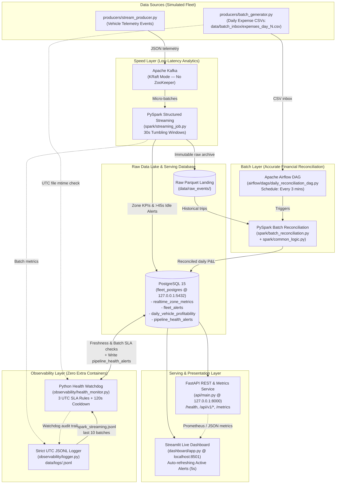

# Ride-Hailing Fleet Operations — End-to-End Lambda Architecture Pipeline

**Course:** EC8203 Applied Big Data Engineering Mini-Project
**Repository:** [github.com/pasi001/ride-hailing-lambda-pipeline](https://github.com/pasi001/ride-hailing-lambda-pipeline)# Ride-Hailing Fleet Operations — End-to-End Lambda Architecture Pipeline


**Course:** EC8203 Applied Big Data Engineering Mini-Project  

**Repository:** [github.com/pasi001/ride-hailing-lambda-pipeline](https://github.com/pasi001/ride-hailing-lambda-pipeline)  

**Target Domain:** Real-Time & Batch Fleet Operations Analytics (Colombo Metro Region)


---


## 1. Project Overview


This project implements a production-inspired **Lambda Architecture** for a simulated ride-hailing fleet operating across **5 Colombo zones** (`Colombo_Central`, `Dehiwala`, `Borella`, `Nugegoda`, `Kaduwela`) with **15 active vehicles**.


The platform decouples low-latency operational monitoring from high-accuracy financial reconciliation while maintaining strict **UTC timestamp consistency** and **end-to-end observability**—engineered specifically to run smoothly on a resource-constrained **Windows 11 (8 GB RAM)** workstation without heavy monitoring stacks.


### Key Operational & Engineering Metrics


| Dimension | Specification / Verified Value |

| :--- | :--- |

| **Fleet Scope** | 15 vehicles across 5 Colombo zones (`Colombo_Central`, `Dehiwala`, `Borella`, `Nugegoda`, `Kaduwela`) |

| **Simulated Time Scale** | 1 Simulated Day = 3 Real Minutes (`180 s`) |

| **Streaming Window** | `30 s` Tumbling Window (PySpark Structured Streaming) |

| **Operational Alert SLA** | Continuous idle duration `> 45 s` triggers `HIGH_IDLE_ALERT` |

| **Pipeline Health SLAs** | Freshness `> 60 s` (CRITICAL), Error Rate `> 5%` (WARNING), Batch SLA `> 240 s` (CRITICAL) |

| **Verified Data Quality Baseline** | `~2.13%` malformed/dropped record rate (safely below the `5%` warning threshold) |

| **Timestamp Standard** | Strict UTC end-to-end (Postgres `timestamp without time zone`, JSONL logs, CSV `mtime`) |

| **Resource Envelope** | Windows 11, 8 GB RAM — zero extra ELK/Prometheus containers |


---


## 2. System Architecture (Lambda + Lightweight Observability)





### Layer Responsibilities

1. **Speed Layer:** `producers/stream_producer.py` emits real-time GPS, trip, and idle-state telemetry into **Kafka (KRaft)**. `spark/streaming_job.py` processes 30-second tumbling windows, flags vehicles idle for `> 45 s` (`HIGH_IDLE_ALERT`), writes live metrics/alerts to PostgreSQL, archives raw events to Parquet (`data/raw_events/`), and records per-batch quality metrics to `data/logs/spark_streaming.jsonl`.

2. **Batch Layer:** Every 3 real minutes (1 simulated day), the Airflow DAG (`airflow/dags/daily_reconciliation_dag.py`) triggers `spark/batch_reconciliation.py` (sharing business rules via `spark/common_logic.py`) to join raw Parquet trip records with daily expense files (`data/batch_inbox/expenses_day_<N>.csv`) and persist reconciled profitability to `daily_vehicle_profitability`.

3. **Serving Layer:** A **FastAPI** backend (`api/main.py`) exposes RESTful operational endpoints and Prometheus-compatible metrics, while a **Streamlit** dashboard (`dashboard/app.py`) delivers live zone analytics, daily P&L views, and an auto-refreshing (5 s via `@st.fragment`) **Active Alerts** console combining business (`fleet_alerts`) and infrastructure (`pipeline_health_alerts`) alerts.

4. **Observability Layer:** `observability/logger.py` emits strict UTC ISO-8601 JSONL logs safely on Windows, and `observability/health_monitor.py` continuously evaluates three automated UTC SLA rules with a **120-second deduplication cooldown** per `(stage, alert_type)`.


---


## 3. Tech Stack & 8 GB RAM Engineering Trade-Offs


Running Kafka, Spark, Airflow, and PostgreSQL concurrently on an 8 GB RAM Windows laptop requires deliberate architectural restraint. Each component was chosen to maximize architectural fidelity while avoiding out-of-memory (OOM) failures:


| Component | Technology Choice | Engineering Justification & 8 GB RAM Trade-Off |

| :--- | :--- | :--- |

| **Message Broker** | **Apache Kafka (KRaft Mode)** | Eliminates the separate ZooKeeper JVM container, saving ~400–600 MB RAM while preserving native Kafka partitioning and replay semantics. |

| **Stream & Batch Compute** | **PySpark (Structured Streaming + Batch)** | Single unified engine across Speed and Batch layers with shared domain logic (`spark/common_logic.py`), preventing metric drift between layers. |

| **Orchestration** | **Apache Airflow** | Industry-standard DAG scheduling for 3-minute simulated daily batch cycles (`daily_reconciliation_dag.py`) with retry and dependency visibility. |

| **Serving Database** | **PostgreSQL 15 (`fleet_postgres`)** | Low memory footprint, ACID transactions for idempotent batch upserts, and clean SQL serving for both FastAPI and Streamlit. |

| **API & Metrics** | **FastAPI (`api/main.py`)** | High-performance async REST API that also serves `/metrics` in **Prometheus text format** and JSON—giving Prometheus-ready instrumentation with zero extra containers. |

| **Visualization** | **Streamlit (`dashboard/app.py`)** | Rapid interactive UI using `@st.fragment` for lightweight 5-second partial refreshes of active alerts without full-page reloads. |

| **Observability** | **Custom UTC JSONL Logger + Python Watchdog** | Replaces heavy ELK (Elasticsearch/Logstash/Kibana) and Prometheus/Grafana containers (~3–4 GB RAM saved) while still delivering structured logs, SLA alerting, and alert deduplication. |

| **Host Execution** | **Windows 11 Python 3.14 `.venv`** | Running producers, FastAPI, Streamlit, and the health monitor natively in `.\.venv\Scripts\python.exe` avoids WSL2/Docker VM memory inflation. |


---


## 4. Simulated Clock & Automated SLA Thresholds


To demonstrate multi-day batch reconciliation alongside sub-minute stream processing during a live evaluation, time is compressed deterministically and governed strictly in **UTC** (preventing `+05:30` local offset drift between Windows host processes and Docker containers).


### Time Compression & Business Rules


| Parameter | Setting | Purpose |

| :--- | :--- | :--- |

| **Simulated Day Duration** | `180 s` (3 real minutes) | Enables rapid observation of multi-day batch reconciliation cycles |

| **Streaming Window** | `30 s` Tumbling Window | Aggregates zone demand, revenue, and fleet status in near real-time |

| **Idle Vehicle Alert** | `> 45 s` continuous idle | Inserts `HIGH_IDLE_ALERT` into `fleet_alerts` for dispatch intervention |

| **Dashboard Alert Refresh** | `5 s` (`@st.fragment`) | Keeps Tab 2 (`Active Alerts`) synchronized with Postgres without flickering |


### Automated Observability Rules (`observability/health_monitor.py`)


| Rule # | Stage | Alert Type | Severity | Trigger Condition (Strict UTC) | Deduplication |

| :---: | :--- | :--- | :---: | :--- | :---: |

| **Rule 1** | `speed_layer` | `NO_DATA_RECEIVED` | `CRITICAL` | `MAX(realtime_zone_metrics.updated_at)` age `> 60 s` | `120 s` cooldown |

| **Rule 2** | `data_quality` | `HIGH_ERROR_RATE` | `WARNING` | Malformed/dropped record rate across last 10 batches of `data/logs/spark_streaming.jsonl` `> 5%` (verified baseline `~2.13%`) | `120 s` cooldown |

| **Rule 3** | `batch_layer` | `BATCH_SLA_BREACH` | `CRITICAL` | Unreconciled `data/batch_inbox/expenses_day_<N>.csv` age `> 240 s` (UTC `mtime` vs `daily_vehicle_profitability.processed_at`) | `120 s` cooldown |


> **Windows Host Convenience:** `health_monitor.py` automatically maps `POSTGRES_HOST=postgres` from `.env` to `127.0.0.1` when executed directly on the Windows host.


---


## 5. Repository Structure


```text

ride-hailing-lambda-pipeline/

├── .env.example                             # Environment template (Postgres, Kafka, paths)

├── .gitignore                               # Excludes .venv, .env, runtime data & logs

├── docker-compose.yml                       # Core containers (Kafka KRaft, Postgres, Airflow, Spark)

├── sql/

│   └── init.sql                             # Schema initialization (metrics, alerts, profitability, health)

├── producers/

│   ├── stream_producer.py                   # Real-time 15-vehicle Colombo telemetry generator

│   ├── batch_generator.py                   # Daily expense CSV generator (expenses_day_<N>.csv)

│   └── requirements.txt

├── spark/

│   ├── __init__.py

│   ├── common_logic.py                      # Shared business calculations across Speed & Batch

│   ├── streaming_job.py                     # PySpark Structured Streaming (30s windows + Parquet landing)

│   └── batch_reconciliation.py              # PySpark Batch job (Parquet + CSV -> daily P&L)

├── airflow/

│   ├── Dockerfile                           # Custom Airflow image with PySpark dependencies

│   └── dags/

│       └── daily_reconciliation_dag.py      # 3-minute scheduled batch reconciliation DAG

├── api/

│   ├── main.py                              # FastAPI serving layer + /metrics endpoint

│   └── requirements.txt

├── dashboard/

│   ├── app.py                               # Streamlit live dashboard (5s auto-refresh alerts)

│   └── requirements.txt

├── observability/

│   ├── logger.py                            # Zero-dependency, Windows-safe UTC JSONL logger

│   └── health_monitor.py                    # Continuous watchdog with CLI flags & 120s cooldown

└── data/

    ├── batch_inbox/.gitkeep                 # Incoming daily expense CSVs

    ├── checkpoints/.gitkeep                 # Spark Structured Streaming checkpoints

    ├── logs/.gitkeep                        # Structured UTC JSONL logs (<stage>.jsonl)

    └── raw_events/.gitkeep                  # Raw Parquet event archive

```


---


## 6. Windows PowerShell Setup & Run Guide


### Prerequisites

* **OS:** Windows 11 (8 GB RAM minimum; close unused browser tabs before launching Docker)

* **Docker Desktop** running with WSL2 backend

* **Python 3.14** virtual environment at `.\.venv\Scripts\python.exe`

* **Port `5432` Check:** Ensure any local Windows PostgreSQL service is **stopped** so Docker's `fleet_postgres` binds cleanly to `127.0.0.1:5432`.


### Step 1: Clone, Environment Setup & Dependencies


```powershell

# 1. Clone the repository and enter the directory

git clone [https://github.com/pasi001/ride-hailing-lambda-pipeline.git](https://github.com/pasi001/ride-hailing-lambda-pipeline.git)

cd ride-hailing-lambda-pipeline


# 2. Create .env from template (verify credentials match sql/init.sql & docker-compose.yml)

Copy-Item .env.example .env


# 3. Verify local Windows PostgreSQL is not occupying port 5432

Get-Service *postgres* | Where-Object {$_.Status -eq "Running"}

# If any local service is running, stop it from an Admin PowerShell:

# Stop-Service -Name "<service-name>"


# 4. Create & populate the Python virtual environment (if not already present)

python -m venv .venv

.\.venv\Scripts\python.exe -m pip install --upgrade pip

.\.venv\Scripts\python.exe -m pip install -r producers/requirements.txt -r api/requirements.txt -r dashboard/requirements.txt

```


### Step 2: Launch Core Infrastructure (Docker Compose)


```powershell

# Start Postgres (fleet_postgres), Kafka (KRaft), Airflow, and Spark services

docker compose up -d


# Verify all containers are healthy and running

docker ps

```


Verify PostgreSQL schema initialization (`fleet_db`):


```powershell

docker exec -it fleet_postgres psql -U fleet_user -d fleet_db -c "\dt"

```


### Step 3: Start Host-Side Data Generators, Serving Layer & Observability


Open dedicated PowerShell tabs in VS Code Insiders / Windows Terminal and run each process using the project venv:


```powershell

# Terminal 1 — Real-Time Telemetry Producer (15 vehicles, 5 Colombo zones)

.\.venv\Scripts\python.exe .\producers\stream_producer.py

```


```powershell

# Terminal 2 — Daily Batch Expense Generator (1 simulated day = 3 real minutes)

.\.venv\Scripts\python.exe .\producers\batch_generator.py

```


```powershell

# Terminal 3 — FastAPI Serving & Metrics Layer ([http://127.0.0.1:8000](http://127.0.0.1:8000))

.\.venv\Scripts\python.exe -m uvicorn api.main:app --host 127.0.0.1 --port 8000

```


```powershell

# Terminal 4 — Streamlit Live Dashboard (http://localhost:8501)

.\.venv\Scripts\python.exe -m streamlit run .\dashboard\app.py --server.port 8501

```


```powershell

# Terminal 5 — Automated UTC Health Watchdog (default 15s polling loop)

.\.venv\Scripts\python.exe .\observability\health_monitor.py

```


> **Tip:** To run a single diagnostic sweep instead of a continuous loop:

> ```powershell

> .\.venv\Scripts\python.exe .\observability\health_monitor.py --once

> ```


---


## 7. API Endpoints Quick Reference


Base URL: `http://127.0.0.1:8000` (Interactive Swagger docs available at `http://127.0.0.1:8000/docs`)


| Method | Endpoint | Description |

| :---: | :--- | :--- |

| `GET` | `/health` | Service liveness and PostgreSQL connectivity check |

| `GET` | `/api/v1/fleet/realtime` | Latest 30-second tumbling window metrics per Colombo zone (`realtime_zone_metrics`) |

| `GET` | `/api/v1/alerts` | Recent operational idle alerts (`fleet_alerts`) and pipeline health alerts (`pipeline_health_alerts`) |

| `GET` | `/api/v1/reports/daily` | Reconciled daily vehicle revenue, expenses, and net profitability (`daily_vehicle_profitability`) |

| `GET` | `/metrics` | Live pipeline & fleet telemetry formatted in **Prometheus text exposition format** |

| `GET` | `/metrics?format=json` | Same operational & data-quality telemetry returned as structured **JSON** |


Quick verification from PowerShell:


```powershell

Invoke-RestMethod [http://127.0.0.1:8000/health](http://127.0.0.1:8000/health)

Invoke-RestMethod "[http://127.0.0.1:8000/metrics?format=json](http://127.0.0.1:8000/metrics?format=json)"

```


---


## 8. Reproducible Observability Failure Simulation Drill


This drill proves end-to-end detection of a **Speed Layer ingestion outage** (Rule 1: `NO_DATA_RECEIVED` / `CRITICAL`) across Postgres, JSONL logs, FastAPI, and the auto-refreshing Streamlit dashboard.


### 1. Start Watchdog in Fast-Trigger Mode (Optional for Live Demos)

By default, Rule 1 triggers after `60 s` of stale data. For rapid testing or live demonstrations (avoiding 60 seconds of dead air), override thresholds via CLI flags:


```powershell

.\.venv\Scripts\python.exe .\observability\health_monitor.py --freshness-sec 15 --interval 5

```


*(Supported flags: `--once`, `--interval`, `--freshness-sec`, `--error-rate-pct`, `--batch-sla-sec`, `--cooldown`.)*


### 2. Inject Failure

* Open **Streamlit** (`http://localhost:8501`) and navigate to **Tab 2 (`Active Alerts`)**.

* Switch to **Terminal 1** running `producers/stream_producer.py` and press **`Ctrl + C`** to simulate an upstream telemetry outage.


### 3. Observe Automated Detection (~15–20 s in fast-trigger mode, ~60–75 s default)

* **Watchdog Console & JSONL Log:** Emits a UTC `CRITICAL` alert for `(speed_layer, NO_DATA_RECEIVED)` and writes to `data/logs/health_monitor.jsonl`.

* **Streamlit Tab 2 (`Active Alerts`):** Auto-refreshes within `5 s` via `@st.fragment` and surfaces the new `CRITICAL` alert without manual page reload.

* **Database Verification:**


```powershell

docker exec -it fleet_postgres psql -U fleet_user -d fleet_db -c "SELECT id, stage, alert_type, severity, message, created_at FROM pipeline_health_alerts ORDER BY created_at DESC LIMIT 5;"

```


* **JSONL Log Inspection:**


```powershell

Get-Content .\data\logs\health_monitor.jsonl -Tail 5

```


* **Cooldown Verification:** Keeping the producer stopped confirms the 120-second deduplication cooldown prevents duplicate rows from spamming `pipeline_health_alerts`.


### 4. Recovery & Drill Cleanup


```powershell

# 1. Restart the stream producer in Terminal 1

.\.venv\Scripts\python.exe .\producers\stream_producer.py


# 2. (Optional) Clear test simulation alerts from Postgres after the drill

docker exec -it fleet_postgres psql -U fleet_user -d fleet_db -c "DELETE FROM pipeline_health_alerts WHERE alert_type = 'NO_DATA_RECEIVED';"


# 3. Restart health_monitor.py with default production thresholds (60s freshness, 15s interval)

.\.venv\Scripts\python.exe .\observability\health_monitor.py

```


---


## 9. Shutdown (Reclaiming 8 GB RAM Cleanly)


```powershell

# Stop host processes with Ctrl+C in each terminal, then stop containers:

docker compose down

```


*(Use `docker compose down -v` only if you want to wipe the PostgreSQL volume and re-run `sql/init.sql` from a clean slate.)*
**Target Domain:** Real-Time & Batch Fleet Operations Analytics (Colombo Metro Region)

---

## 1. Project Overview

This project implements a production-inspired **Lambda Architecture** for a s# Ride-Hailing Fleet Operations — End-to-End Lambda Architecture Pipeline


**Course:** EC8203 Applied Big Data Engineering Mini-Project  

**Repository:** [github.com/pasi001/ride-hailing-lambda-pipeline](https://github.com/pasi001/ride-hailing-lambda-pipeline)  

**Target Domain:** Real-Time & Batch Fleet Operations Analytics (Colombo Metro Region)


---


## 1. Project Overview


This project implements a production-inspired **Lambda Architecture** for a simulated ride-hailing fleet operating across **5 Colombo zones** (`Colombo_Central`, `Dehiwala`, `Borella`, `Nugegoda`, `Kaduwela`) with **15 active vehicles**.


The platform decouples low-latency operational monitoring from high-accuracy financial reconciliation while maintaining strict **UTC timestamp consistency** and **end-to-end observability**—engineered specifically to run smoothly on a resource-constrained **Windows 11 (8 GB RAM)** workstation without heavy monitoring stacks.


### Key Operational & Engineering Metrics


| Dimension | Specification / Verified Value |

| :--- | :--- |

| **Fleet Scope** | 15 vehicles across 5 Colombo zones (`Colombo_Central`, `Dehiwala`, `Borella`, `Nugegoda`, `Kaduwela`) |

| **Simulated Time Scale** | 1 Simulated Day = 3 Real Minutes (`180 s`) |

| **Streaming Window** | `30 s` Tumbling Window (PySpark Structured Streaming) |

| **Operational Alert SLA** | Continuous idle duration `> 45 s` triggers `HIGH_IDLE_ALERT` |

| **Pipeline Health SLAs** | Freshness `> 60 s` (CRITICAL), Error Rate `> 5%` (WARNING), Batch SLA `> 240 s` (CRITICAL) |

| **Verified Data Quality Baseline** | `~2.13%` malformed/dropped record rate (safely below the `5%` warning threshold) |

| **Timestamp Standard** | Strict UTC end-to-end (Postgres `timestamp without time zone`, JSONL logs, CSV `mtime`) |

| **Resource Envelope** | Windows 11, 8 GB RAM — zero extra ELK/Prometheus containers |


---


## 2. System Architecture (Lambda + Lightweight Observability)


### Layer Responsibilities

1. **Speed Layer:** `producers/stream_producer.py` emits real-time GPS, trip, and idle-state telemetry into **Kafka (KRaft)**. `spark/streaming_job.py` processes 30-second tumbling windows, flags vehicles idle for `> 45 s` (`HIGH_IDLE_ALERT`), writes live metrics/alerts to PostgreSQL, archives raw events to Parquet (`data/raw_events/`), and records per-batch quality metrics to `data/logs/spark_streaming.jsonl`.

2. **Batch Layer:** Every 3 real minutes (1 simulated day), the Airflow DAG (`airflow/dags/daily_reconciliation_dag.py`) triggers `spark/batch_reconciliation.py` (sharing business rules via `spark/common_logic.py`) to join raw Parquet trip records with daily expense files (`data/batch_inbox/expenses_day_<N>.csv`) and persist reconciled profitability to `daily_vehicle_profitability`.

3. **Serving Layer:** A **FastAPI** backend (`api/main.py`) exposes RESTful operational endpoints and Prometheus-compatible metrics, while a **Streamlit** dashboard (`dashboard/app.py`) delivers live zone analytics, daily P&L views, and an auto-refreshing (5 s via `@st.fragment`) **Active Alerts** console combining business (`fleet_alerts`) and infrastructure (`pipeline_health_alerts`) alerts.

4. **Observability Layer:** `observability/logger.py` emits strict UTC ISO-8601 JSONL logs safely on Windows, and `observability/health_monitor.py` continuously evaluates three automated UTC SLA rules with a **120-second deduplication cooldown** per `(stage, alert_type)`.


---


## 3. Tech Stack & 8 GB RAM Engineering Trade-Offs


Running Kafka, Spark, Airflow, and PostgreSQL concurrently on an 8 GB RAM Windows laptop requires deliberate architectural restraint. Each component was chosen to maximize architectural fidelity while avoiding out-of-memory (OOM) failures:


| Component | Technology Choice | Engineering Justification & 8 GB RAM Trade-Off |

| :--- | :--- | :--- |

| **Message Broker** | **Apache Kafka (KRaft Mode)** | Eliminates the separate ZooKeeper JVM container, saving ~400–600 MB RAM while preserving native Kafka partitioning and replay semantics. |

| **Stream & Batch Compute** | **PySpark (Structured Streaming + Batch)** | Single unified engine across Speed and Batch layers with shared domain logic (`spark/common_logic.py`), preventing metric drift between layers. |

| **Orchestration** | **Apache Airflow** | Industry-standard DAG scheduling for 3-minute simulated daily batch cycles (`daily_reconciliation_dag.py`) with retry and dependency visibility. |

| **Serving Database** | **PostgreSQL 15 (`fleet_postgres`)** | Low memory footprint, ACID transactions for idempotent batch upserts, and clean SQL serving for both FastAPI and Streamlit. |

| **API & Metrics** | **FastAPI (`api/main.py`)** | High-performance async REST API that also serves `/metrics` in **Prometheus text format** and JSON—giving Prometheus-ready instrumentation with zero extra containers. |

| **Visualization** | **Streamlit (`dashboard/app.py`)** | Rapid interactive UI using `@st.fragment` for lightweight 5-second partial refreshes of active alerts without full-page reloads. |

| **Observability** | **Custom UTC JSONL Logger + Python Watchdog** | Replaces heavy ELK (Elasticsearch/Logstash/Kibana) and Prometheus/Grafana containers (~3–4 GB RAM saved) while still delivering structured logs, SLA alerting, and alert deduplication. |

| **Host Execution** | **Windows 11 Python 3.14 `.venv`** | Running producers, FastAPI, Streamlit, and the health monitor natively in `.\.venv\Scripts\python.exe` avoids WSL2/Docker VM memory inflation. |


---


## 4. Simulated Clock & Automated SLA Thresholds


To demonstrate multi-day batch reconciliation alongside sub-minute stream processing during a live evaluation, time is compressed deterministically and governed strictly in **UTC** (preventing `+05:30` local offset drift between Windows host processes and Docker containers).


### Time Compression & Business Rules


| Parameter | Setting | Purpose |

| :--- | :--- | :--- |

| **Simulated Day Duration** | `180 s` (3 real minutes) | Enables rapid observation of multi-day batch reconciliation cycles |

| **Streaming Window** | `30 s` Tumbling Window | Aggregates zone demand, revenue, and fleet status in near real-time |

| **Idle Vehicle Alert** | `> 45 s` continuous idle | Inserts `HIGH_IDLE_ALERT` into `fleet_alerts` for dispatch intervention |

| **Dashboard Alert Refresh** | `5 s` (`@st.fragment`) | Keeps Tab 2 (`Active Alerts`) synchronized with Postgres without flickering |


### Automated Observability Rules (`observability/health_monitor.py`)


| Rule # | Stage | Alert Type | Severity | Trigger Condition (Strict UTC) | Deduplication |

| :---: | :--- | :--- | :---: | :--- | :---: |

| **Rule 1** | `speed_layer` | `NO_DATA_RECEIVED` | `CRITICAL` | `MAX(realtime_zone_metrics.updated_at)` age `> 60 s` | `120 s` cooldown |

| **Rule 2** | `data_quality` | `HIGH_ERROR_RATE` | `WARNING` | Malformed/dropped record rate across last 10 batches of `data/logs/spark_streaming.jsonl` `> 5%` (verified baseline `~2.13%`) | `120 s` cooldown |

| **Rule 3** | `batch_layer` | `BATCH_SLA_BREACH` | `CRITICAL` | Unreconciled `data/batch_inbox/expenses_day_<N>.csv` age `> 240 s` (UTC `mtime` vs `daily_vehicle_profitability.processed_at`) | `120 s` cooldown |


> **Windows Host Convenience:** `health_monitor.py` automatically maps `POSTGRES_HOST=postgres` from `.env` to `127.0.0.1` when executed directly on the Windows host.


---


## 5. Repository Structure


```text

ride-hailing-lambda-pipeline/

├── .env.example                             # Environment template (Postgres, Kafka, paths)

├── .gitignore                               # Excludes .venv, .env, runtime data & logs

├── docker-compose.yml                       # Core containers (Kafka KRaft, Postgres, Airflow, Spark)

├── sql/

│   └── init.sql                             # Schema initialization (metrics, alerts, profitability, health)

├── producers/

│   ├── stream_producer.py                   # Real-time 15-vehicle Colombo telemetry generator

│   ├── batch_generator.py                   # Daily expense CSV generator (expenses_day_<N>.csv)

│   └── requirements.txt

├── spark/

│   ├── __init__.py

│   ├── common_logic.py                      # Shared business calculations across Speed & Batch

│   ├── streaming_job.py                     # PySpark Structured Streaming (30s windows + Parquet landing)

│   └── batch_reconciliation.py              # PySpark Batch job (Parquet + CSV -> daily P&L)

├── airflow/

│   ├── Dockerfile                           # Custom Airflow image with PySpark dependencies

│   └── dags/

│       └── daily_reconciliation_dag.py      # 3-minute scheduled batch reconciliation DAG

├── api/

│   ├── main.py                              # FastAPI serving layer + /metrics endpoint

│   └── requirements.txt

├── dashboard/

│   ├── app.py                               # Streamlit live dashboard (5s auto-refresh alerts)

│   └── requirements.txt

├── observability/

│   ├── logger.py                            # Zero-dependency, Windows-safe UTC JSONL logger

│   └── health_monitor.py                    # Continuous watchdog with CLI flags & 120s cooldown

└── data/

    ├── batch_inbox/.gitkeep                 # Incoming daily expense CSVs

    ├── checkpoints/.gitkeep                 # Spark Structured Streaming checkpoints

    ├── logs/.gitkeep                        # Structured UTC JSONL logs (<stage>.jsonl)

    └── raw_events/.gitkeep                  # Raw Parquet event archive

```


---


## 6. Windows PowerShell Setup & Run Guide


### Prerequisites

* **OS:** Windows 11 (8 GB RAM minimum; close unused browser tabs before launching Docker)

* **Docker Desktop** running with WSL2 backend

* **Python 3.14** virtual environment at `.\.venv\Scripts\python.exe`

* **Port `5432` Check:** Ensure any local Windows PostgreSQL service is **stopped** so Docker's `fleet_postgres` binds cleanly to `127.0.0.1:5432`.


### Step 1: Clone, Environment Setup & Dependencies


```powershell

# 1. Clone the repository and enter the directory

git clone [https://github.com/pasi001/ride-hailing-lambda-pipeline.git](https://github.com/pasi001/ride-hailing-lambda-pipeline.git)

cd ride-hailing-lambda-pipeline


# 2. Create .env from template (verify credentials match sql/init.sql & docker-compose.yml)

Copy-Item .env.example .env


# 3. Verify local Windows PostgreSQL is not occupying port 5432

Get-Service *postgres* | Where-Object {$_.Status -eq "Running"}

# If any local service is running, stop it from an Admin PowerShell:

# Stop-Service -Name "<service-name>"


# 4. Create & populate the Python virtual environment (if not already present)

python -m venv .venv

.\.venv\Scripts\python.exe -m pip install --upgrade pip

.\.venv\Scripts\python.exe -m pip install -r producers/requirements.txt -r api/requirements.txt -r dashboard/requirements.txt

```


### Step 2: Launch Core Infrastructure (Docker Compose)


```powershell

# Start Postgres (fleet_postgres), Kafka (KRaft), Airflow, and Spark services

docker compose up -d


# Verify all containers are healthy and running

docker ps

```


Verify PostgreSQL schema initialization (`fleet_db`):


```powershell

docker exec -it fleet_postgres psql -U fleet_user -d fleet_db -c "\dt"

```


### Step 3: Start Host-Side Data Generators, Serving Layer & Observability


Open dedicated PowerShell tabs in VS Code Insiders / Windows Terminal and run each process using the project venv:


```powershell

# Terminal 1 — Real-Time Telemetry Producer (15 vehicles, 5 Colombo zones)

.\.venv\Scripts\python.exe .\producers\stream_producer.py

```


```powershell

# Terminal 2 — Daily Batch Expense Generator (1 simulated day = 3 real minutes)

.\.venv\Scripts\python.exe .\producers\batch_generator.py

```


```powershell

# Terminal 3 — FastAPI Serving & Metrics Layer ([http://127.0.0.1:8000](http://127.0.0.1:8000))

.\.venv\Scripts\python.exe -m uvicorn api.main:app --host 127.0.0.1 --port 8000

```


```powershell

# Terminal 4 — Streamlit Live Dashboard (http://localhost:8501)

.\.venv\Scripts\python.exe -m streamlit run .\dashboard\app.py --server.port 8501

```


```powershell

# Terminal 5 — Automated UTC Health Watchdog (default 15s polling loop)

.\.venv\Scripts\python.exe .\observability\health_monitor.py

```


> **Tip:** To run a single diagnostic sweep instead of a continuous loop:

> ```powershell

> .\.venv\Scripts\python.exe .\observability\health_monitor.py --once

> ```


---


## 7. API Endpoints Quick Reference


Base URL: `http://127.0.0.1:8000` (Interactive Swagger docs available at `http://127.0.0.1:8000/docs`)


| Method | Endpoint | Description |

| :---: | :--- | :--- |

| `GET` | `/health` | Service liveness and PostgreSQL connectivity check |

| `GET` | `/api/v1/fleet/realtime` | Latest 30-second tumbling window metrics per Colombo zone (`realtime_zone_metrics`) |

| `GET` | `/api/v1/alerts` | Recent operational idle alerts (`fleet_alerts`) and pipeline health alerts (`pipeline_health_alerts`) |

| `GET` | `/api/v1/reports/daily` | Reconciled daily vehicle revenue, expenses, and net profitability (`daily_vehicle_profitability`) |

| `GET` | `/metrics` | Live pipeline & fleet telemetry formatted in **Prometheus text exposition format** |

| `GET` | `/metrics?format=json` | Same operational & data-quality telemetry returned as structured **JSON** |


Quick verification from PowerShell:


```powershell

Invoke-RestMethod [http://127.0.0.1:8000/health](http://127.0.0.1:8000/health)

Invoke-RestMethod "[http://127.0.0.1:8000/metrics?format=json](http://127.0.0.1:8000/metrics?format=json)"

```


---


## 8. Reproducible Observability Failure Simulation Drill


This drill proves end-to-end detection of a **Speed Layer ingestion outage** (Rule 1: `NO_DATA_RECEIVED` / `CRITICAL`) across Postgres, JSONL logs, FastAPI, and the auto-refreshing Streamlit dashboard.


### 1. Start Watchdog in Fast-Trigger Mode (Optional for Live Demos)

By default, Rule 1 triggers after `60 s` of stale data. For rapid testing or live demonstrations (avoiding 60 seconds of dead air), override thresholds via CLI flags:


```powershell

.\.venv\Scripts\python.exe .\observability\health_monitor.py --freshness-sec 15 --interval 5

```


*(Supported flags: `--once`, `--interval`, `--freshness-sec`, `--error-rate-pct`, `--batch-sla-sec`, `--cooldown`.)*


### 2. Inject Failure

* Open **Streamlit** (`http://localhost:8501`) and navigate to **Tab 2 (`Active Alerts`)**.

* Switch to **Terminal 1** running `producers/stream_producer.py` and press **`Ctrl + C`** to simulate an upstream telemetry outage.


### 3. Observe Automated Detection (~15–20 s in fast-trigger mode, ~60–75 s default)

* **Watchdog Console & JSONL Log:** Emits a UTC `CRITICAL` alert for `(speed_layer, NO_DATA_RECEIVED)` and writes to `data/logs/health_monitor.jsonl`.

* **Streamlit Tab 2 (`Active Alerts`):** Auto-refreshes within `5 s` via `@st.fragment` and surfaces the new `CRITICAL` alert without manual page reload.

* **Database Verification:**


```powershell

docker exec -it fleet_postgres psql -U fleet_user -d fleet_db -c "SELECT id, stage, alert_type, severity, message, created_at FROM pipeline_health_alerts ORDER BY created_at DESC LIMIT 5;"

```


* **JSONL Log Inspection:**


```powershell

Get-Content .\data\logs\health_monitor.jsonl -Tail 5

```


* **Cooldown Verification:** Keeping the producer stopped confirms the 120-second deduplication cooldown prevents duplicate rows from spamming `pipeline_health_alerts`.


### 4. Recovery & Drill Cleanup


```powershell

# 1. Restart the stream producer in Terminal 1

.\.venv\Scripts\python.exe .\producers\stream_producer.py


# 2. (Optional) Clear test simulation alerts from Postgres after the drill

docker exec -it fleet_postgres psql -U fleet_user -d fleet_db -c "DELETE FROM pipeline_health_alerts WHERE alert_type = 'NO_DATA_RECEIVED';"


# 3. Restart health_monitor.py with default production thresholds (60s freshness, 15s interval)

.\.venv\Scripts\python.exe .\observability\health_monitor.py

```


---


## 9. Shutdown (Reclaiming 8 GB RAM Cleanly)


```powershell

# Stop host processes with Ctrl+C in each terminal, then stop containers:

docker compose down

```


*(Use `docker compose down -v` only if you want to wipe the PostgreSQL volume and re-run `sql/init.sql` from a clean slate.)*imulated ride-hailing fleet operating across **5 Colombo zones** (`Colombo_Central`, `Dehiwala`, `Borella`, `Nugegoda`, `Kaduwela`) with **15 active vehicles**.

The platform decouples low-latency operational monitoring from high-accuracy financial reconciliation while maintaining strict **UTC timestamp consistency** and **end-to-end observability**—engineered specifically to run smoothly on a resource-constrained **Windows 11 (8 GB RAM)** workstation without heavy monitoring stacks.

### Key Operational & Engineering Metrics

| Dimension                                | Specification / Verified Value                                                                                  |
| :--------------------------------------- | :-------------------------------------------------------------------------------------------------------------- |
| **Fleet Scope**                    | 15 vehicles across 5 Colombo zones (`Colombo_Central`, `Dehiwala`, `Borella`, `Nugegoda`, `Kaduwela`) |
| **Simulated Time Scale**           | 1 Simulated Day = 3 Real Minutes (`180 s`)                                                                    |
| **Streaming Window**               | `30 s` Tumbling Window (PySpark Structured Streaming)                                                         |
| **Operational Alert SLA**          | Continuous idle duration `> 45 s` triggers `HIGH_IDLE_ALERT`                                                |
| **Pipeline Health SLAs**           | Freshness `> 60 s` (CRITICAL), Error Rate `> 5%` (WARNING), Batch SLA `> 240 s` (CRITICAL)                |
| **Verified Data Quality Baseline** | `~2.13%` malformed/dropped record rate (safely below the `5%` warning threshold)                            |
| **Timestamp Standard**             | Strict UTC end-to-end (Postgres `timestamp without time zone`, JSONL logs, CSV `mtime`)                     |
| **Resource Envelope**              | Windows 11, 8 GB RAM — zero extra ELK/Prometheus containers                                                    |

---

## 2. System Architecture (Lambda + Lightweight Observability)


### Layer Responsibilities

1. **Speed Layer:** `producers/stream_producer.py` emits real-time GPS, trip, and idle-state telemetry into **Kafka (KRaft)**. `spark/streaming_job.py` processes 30-second tumbling windows, flags vehicles idle for `> 45 s` (`HIGH_IDLE_ALERT`), writes live metrics/alerts to PostgreSQL, archives raw events to Parquet (`data/raw_events/`), and records per-batch quality metrics to `data/logs/spark_streaming.jsonl`.
2. **Batch Layer:** Every 3 real minutes (1 simulated day), the Airflow DAG (`airflow/dags/daily_reconciliation_dag.py`) triggers `spark/batch_reconciliation.py` (sharing business rules via `spark/common_logic.py`) to join raw Parquet trip records with daily expense files (`data/batch_inbox/expenses_day_<N>.csv`) and persist reconciled profitability to `daily_vehicle_profitability`.
3. **Serving Layer:** A **FastAPI** backend (`api/main.py`) exposes RESTful operational endpoints and Prometheus-compatible metrics, while a **Streamlit** dashboard (`dashboard/app.py`) delivers live zone analytics, daily P&L views, and an auto-refreshing (5 s via `@st.fragment`) **Active Alerts** console combining business (`fleet_alerts`) and infrastructure (`pipeline_health_alerts`) alerts.
4. **Observability Layer:** `observability/logger.py` emits strict UTC ISO-8601 JSONL logs safely on Windows, and `observability/health_monitor.py` continuously evaluates three automated UTC SLA rules with a **120-second deduplication cooldown** per `(stage, alert_type)`.

---

## 3. Tech Stack & 8 GB RAM Engineering Trade-Offs

Running Kafka, Spark, Airflow, and PostgreSQL concurrently on an 8 GB RAM Windows laptop requires deliberate architectural restraint. Each component was chosen to maximize architectural fidelity while avoiding out-of-memory (OOM) failures:

| Component                        | Technology Choice                                   | Engineering Justification & 8 GB RAM Trade-Off                                                                                                                                           |
| :------------------------------- | :-------------------------------------------------- | :--------------------------------------------------------------------------------------------------------------------------------------------------------------------------------------- |
| **Message Broker**         | **Apache Kafka (KRaft Mode)**                 | Eliminates the separate ZooKeeper JVM container, saving ~400–600 MB RAM while preserving native Kafka partitioning and replay semantics.                                                |
| **Stream & Batch Compute** | **PySpark (Structured Streaming + Batch)**    | Single unified engine across Speed and Batch layers with shared domain logic (`spark/common_logic.py`), preventing metric drift between layers.                                        |
| **Orchestration**          | **Apache Airflow**                            | Industry-standard DAG scheduling for 3-minute simulated daily batch cycles (`daily_reconciliation_dag.py`) with retry and dependency visibility.                                       |
| **Serving Database**       | **PostgreSQL 15 (`fleet_postgres`)**        | Low memory footprint, ACID transactions for idempotent batch upserts, and clean SQL serving for both FastAPI and Streamlit.                                                              |
| **API & Metrics**          | **FastAPI (`api/main.py`)**                 | High-performance async REST API that also serves `/metrics` in **Prometheus text format** and JSON—giving Prometheus-ready instrumentation with zero extra containers.          |
| **Visualization**          | **Streamlit (`dashboard/app.py`)**          | Rapid interactive UI using `@st.fragment` for lightweight 5-second partial refreshes of active alerts without full-page reloads.                                                       |
| **Observability**          | **Custom UTC JSONL Logger + Python Watchdog** | Replaces heavy ELK (Elasticsearch/Logstash/Kibana) and Prometheus/Grafana containers (~3–4 GB RAM saved) while still delivering structured logs, SLA alerting, and alert deduplication. |
| **Host Execution**         | **Windows 11 Python 3.14 `.venv`**          | Running producers, FastAPI, Streamlit, and the health monitor natively in `.\.venv\Scripts\python.exe` avoids WSL2/Docker VM memory inflation.                                         |

---

## 4. Simulated Clock & Automated SLA Thresholds

To demonstrate multi-day batch reconciliation alongside sub-minute stream processing during a live evaluation, time is compressed deterministically and governed strictly in **UTC** (preventing `+05:30` local offset drift between Windows host processes and Docker containers).

### Time Compression & Business Rules

| Parameter                         | Setting                    | Purpose                                                                       |
| :-------------------------------- | :------------------------- | :---------------------------------------------------------------------------- |
| **Simulated Day Duration**  | `180 s` (3 real minutes) | Enables rapid observation of multi-day batch reconciliation cycles            |
| **Streaming Window**        | `30 s` Tumbling Window   | Aggregates zone demand, revenue, and fleet status in near real-time           |
| **Idle Vehicle Alert**      | `> 45 s` continuous idle | Inserts `HIGH_IDLE_ALERT` into `fleet_alerts` for dispatch intervention   |
| **Dashboard Alert Refresh** | `5 s` (`@st.fragment`) | Keeps Tab 2 (`Active Alerts`) synchronized with Postgres without flickering |

### Automated Observability Rules (`observability/health_monitor.py`)

|      Rule #      | Stage            | Alert Type           |   Severity   | Trigger Condition (Strict UTC)                                                                                                         |   Deduplication   |
| :--------------: | :--------------- | :------------------- | :----------: | :------------------------------------------------------------------------------------------------------------------------------------- | :----------------: |
| **Rule 1** | `speed_layer`  | `NO_DATA_RECEIVED` | `CRITICAL` | `MAX(realtime_zone_metrics.updated_at)` age `> 60 s`                                                                               | `120 s` cooldown |
| **Rule 2** | `data_quality` | `HIGH_ERROR_RATE`  | `WARNING` | Malformed/dropped record rate across last 10 batches of `data/logs/spark_streaming.jsonl` `> 5%` (verified baseline `~2.13%`)    | `120 s` cooldown |
| **Rule 3** | `batch_layer`  | `BATCH_SLA_BREACH` | `CRITICAL` | Unreconciled `data/batch_inbox/expenses_day_<N>.csv` age `> 240 s` (UTC `mtime` vs `daily_vehicle_profitability.processed_at`) | `120 s` cooldown |

> **Windows Host Convenience:** `health_monitor.py` automatically maps `POSTGRES_HOST=postgres` from `.env` to `127.0.0.1` when executed directly on the Windows host.

---

## 5. Repository Structure

```text
ride-hailing-lambda-pipeline/
├── .env.example                             # Environment template (Postgres, Kafka, paths)
├── .gitignore                               # Excludes .venv, .env, runtime data & logs
├── docker-compose.yml                       # Core containers (Kafka KRaft, Postgres, Airflow, Spark)
├── sql/
│   └── init.sql                             # Schema initialization (metrics, alerts, profitability, health)
├── producers/
│   ├── stream_producer.py                   # Real-time 15-vehicle Colombo telemetry generator
│   ├── batch_generator.py                   # Daily expense CSV generator (expenses_day_<N>.csv)
│   └── requirements.txt
├── spark/
│   ├── __init__.py
│   ├── common_logic.py                      # Shared business calculations across Speed & Batch
│   ├── streaming_job.py                     # PySpark Structured Streaming (30s windows + Parquet landing)
│   └── batch_reconciliation.py              # PySpark Batch job (Parquet + CSV -> daily P&L)
├── airflow/
│   ├── Dockerfile                           # Custom Airflow image with PySpark dependencies
│   └── dags/
│       └── daily_reconciliation_dag.py      # 3-minute scheduled batch reconciliation DAG
├── api/
│   ├── main.py                              # FastAPI serving layer + /metrics endpoint
│   └── requirements.txt
├── dashboard/
│   ├── app.py                               # Streamlit live dashboard (5s auto-refresh alerts)
│   └── requirements.txt
├── observability/
│   ├── logger.py                            # Zero-dependency, Windows-safe UTC JSONL logger
│   └── health_monitor.py                    # Continuous watchdog with CLI flags & 120s cooldown
└── data/
    ├── batch_inbox/.gitkeep                 # Incoming daily expense CSVs
    ├── checkpoints/.gitkeep                 # Spark Structured Streaming checkpoints
    ├── logs/.gitkeep                        # Structured UTC JSONL logs (<stage>.jsonl)
    └── raw_events/.gitkeep                  # Raw Parquet event archive
```

---

## 6. Windows PowerShell Setup & Run Guide

### Prerequisites

* **OS:** Windows 11 (8 GB RAM minimum; close unused browser tabs before launching Docker)
* **Docker Desktop** running with WSL2 backend
* **Python 3.14** virtual environment at `.\.venv\Scripts\python.exe`
* **Port `5432` Check:** Ensure any local Windows PostgreSQL service is **stopped** so Docker's `fleet_postgres` binds cleanly to `127.0.0.1:5432`.

### Step 1: Clone, Environment Setup & Dependencies

```powershell
# 1. Clone the repository and enter the directory
git clone [https://github.com/pasi001/ride-hailing-lambda-pipeline.git](https://github.com/pasi001/ride-hailing-lambda-pipeline.git)
cd ride-hailing-lambda-pipeline

# 2. Create .env from template (verify credentials match sql/init.sql & docker-compose.yml)
Copy-Item .env.example .env

# 3. Verify local Windows PostgreSQL is not occupying port 5432
Get-Service *postgres* | Where-Object {$_.Status -eq "Running"}
# If any local service is running, stop it from an Admin PowerShell:
# Stop-Service -Name "<service-name>"

# 4. Create & populate the Python virtual environment (if not already present)
python -m venv .venv
.\.venv\Scripts\python.exe -m pip install --upgrade pip
.\.venv\Scripts\python.exe -m pip install -r producers/requirements.txt -r api/requirements.txt -r dashboard/requirements.txt
```

### Step 2: Launch Core Infrastructure (Docker Compose)

```powershell
# Start Postgres (fleet_postgres), Kafka (KRaft), Airflow, and Spark services
docker compose up -d

# Verify all containers are healthy and running
docker ps
```

Verify PostgreSQL schema initialization (`fleet_db`):

```powershell
docker exec -it fleet_postgres psql -U fleet_user -d fleet_db -c "\dt"
```

### Step 3: Start Host-Side Data Generators, Serving Layer & Observability

Open dedicated PowerShell tabs in VS Code Insiders / Windows Terminal and run each process using the project venv:

```powershell
# Terminal 1 — Real-Time Telemetry Producer (15 vehicles, 5 Colombo zones)
.\.venv\Scripts\python.exe .\producers\stream_producer.py
```

```powershell
# Terminal 2 — Daily Batch Expense Generator (1 simulated day = 3 real minutes)
.\.venv\Scripts\python.exe .\producers\batch_generator.py
```

```powershell
# Terminal 3 — FastAPI Serving & Metrics Layer ([http://127.0.0.1:8000](http://127.0.0.1:8000))
.\.venv\Scripts\python.exe -m uvicorn api.main:app --host 127.0.0.1 --port 8000
```

```powershell
# Terminal 4 — Streamlit Live Dashboard (http://localhost:8501)
.\.venv\Scripts\python.exe -m streamlit run .\dashboard\app.py --server.port 8501
```

```powershell
# Terminal 5 — Automated UTC Health Watchdog (default 15s polling loop)
.\.venv\Scripts\python.exe .\observability\health_monitor.py
```

> **Tip:** To run a single diagnostic sweep instead of a continuous loop:
>
> ```powershell
> .\.venv\Scripts\python.exe .\observability\health_monitor.py --once
> ```

---

## 7. API Endpoints Quick Reference

Base URL: `http://127.0.0.1:8000` (Interactive Swagger docs available at `http://127.0.0.1:8000/docs`)

| Method | Endpoint                   | Description                                                                                               |
| :-----: | :------------------------- | :-------------------------------------------------------------------------------------------------------- |
| `GET` | `/health`                | Service liveness and PostgreSQL connectivity check                                                        |
| `GET` | `/api/v1/fleet/realtime` | Latest 30-second tumbling window metrics per Colombo zone (`realtime_zone_metrics`)                     |
| `GET` | `/api/v1/alerts`         | Recent operational idle alerts (`fleet_alerts`) and pipeline health alerts (`pipeline_health_alerts`) |
| `GET` | `/api/v1/reports/daily`  | Reconciled daily vehicle revenue, expenses, and net profitability (`daily_vehicle_profitability`)       |
| `GET` | `/metrics`               | Live pipeline & fleet telemetry formatted in **Prometheus text exposition format**                  |
| `GET` | `/metrics?format=json`   | Same operational & data-quality telemetry returned as structured **JSON**                           |

Quick verification from PowerShell:

```powershell
Invoke-RestMethod [http://127.0.0.1:8000/health](http://127.0.0.1:8000/health)
Invoke-RestMethod "[http://127.0.0.1:8000/metrics?format=json](http://127.0.0.1:8000/metrics?format=json)"
```

---

## 8. Reproducible Observability Failure Simulation Drill

This drill proves end-to-end detection of a **Speed Layer ingestion outage** (Rule 1: `NO_DATA_RECEIVED` / `CRITICAL`) across Postgres, JSONL logs, FastAPI, and the auto-refreshing Streamlit dashboard.

### 1. Start Watchdog in Fast-Trigger Mode (Optional for Live Demos)

By default, Rule 1 triggers after `60 s` of stale data. For rapid testing or live demonstrations (avoiding 60 seconds of dead air), override thresholds via CLI flags:

```powershell
.\.venv\Scripts\python.exe .\observability\health_monitor.py --freshness-sec 15 --interval 5
```

*(Supported flags: `--once`, `--interval`, `--freshness-sec`, `--error-rate-pct`, `--batch-sla-sec`, `--cooldown`.)*

### 2. Inject Failure

* Open **Streamlit** (`http://localhost:8501`) and navigate to **Tab 2 (`Active Alerts`)**.
* Switch to **Terminal 1** running `producers/stream_producer.py` and press **`Ctrl + C`** to simulate an upstream telemetry outage.

### 3. Observe Automated Detection (~15–20 s in fast-trigger mode, ~60–75 s default)

* **Watchdog Console & JSONL Log:** Emits a UTC `CRITICAL` alert for `(speed_layer, NO_DATA_RECEIVED)` and writes to `data/logs/health_monitor.jsonl`.
* **Streamlit Tab 2 (`Active Alerts`):** Auto-refreshes within `5 s` via `@st.fragment` and surfaces the new `CRITICAL` alert without manual page reload.
* **Database Verification:**

```powershell
docker exec -it fleet_postgres psql -U fleet_user -d fleet_db -c "SELECT id, stage, alert_type, severity, message, created_at FROM pipeline_health_alerts ORDER BY created_at DESC LIMIT 5;"
```

* **JSONL Log Inspection:**

```powershell
Get-Content .\data\logs\health_monitor.jsonl -Tail 5
```

* **Cooldown Verification:** Keeping the producer stopped confirms the 120-second deduplication cooldown prevents duplicate rows from spamming `pipeline_health_alerts`.

### 4. Recovery & Drill Cleanup

```powershell
# 1. Restart the stream producer in Terminal 1
.\.venv\Scripts\python.exe .\producers\stream_producer.py

# 2. (Optional) Clear test simulation alerts from Postgres after the drill
docker exec -it fleet_postgres psql -U fleet_user -d fleet_db -c "DELETE FROM pipeline_health_alerts WHERE alert_type = 'NO_DATA_RECEIVED';"

# 3. Restart health_monitor.py with default production thresholds (60s freshness, 15s interval)
.\.venv\Scripts\python.exe .\observability\health_monitor.py
```

---

## 9. Shutdown (Reclaiming 8 GB RAM Cleanly)

```powershell
# Stop host processes with Ctrl+C in each terminal, then stop containers:
docker compose down
```

*(Use `docker compose down -v` only if you want to wipe the PostgreSQL volume and re-run `sql/init.sql` from a clean slate.)*# Ride-Hailing Fleet Operations — End-to-End Lambda Architecture Pipeline


**Course:** EC8203 Applied Big Data Engineering Mini-Project  

**Repository:** [github.com/pasi001/ride-hailing-lambda-pipeline](https://github.com/pasi001/ride-hailing-lambda-pipeline)  

**Target Domain:** Real-Time & Batch Fleet Operations Analytics (Colombo Metro Region)


---


## 1. Project Overview


This project implements a production-inspired **Lambda Architecture** for a simulated ride-hailing fleet operating across **5 Colombo zones** (`Colombo_Central`, `Dehiwala`, `Borella`, `Nugegoda`, `Kaduwela`) with **15 active vehicles**.


The platform decouples low-latency operational monitoring from high-accuracy financial reconciliation while maintaining strict **UTC timestamp consistency** and **end-to-end observability**—engineered specifically to run smoothly on a resource-constrained **Windows 11 (8 GB RAM)** workstation without heavy monitoring stacks.


### Key Operational & Engineering Metrics


| Dimension | Specification / Verified Value |

| :--- | :--- |

| **Fleet Scope** | 15 vehicles across 5 Colombo zones (`Colombo_Central`, `Dehiwala`, `Borella`, `Nugegoda`, `Kaduwela`) |

| **Simulated Time Scale** | 1 Simulated Day = 3 Real Minutes (`180 s`) |

| **Streaming Window** | `30 s` Tumbling Window (PySpark Structured Streaming) |

| **Operational Alert SLA** | Continuous idle duration `> 45 s` triggers `HIGH_IDLE_ALERT` |

| **Pipeline Health SLAs** | Freshness `> 60 s` (CRITICAL), Error Rate `> 5%` (WARNING), Batch SLA `> 240 s` (CRITICAL) |

| **Verified Data Quality Baseline** | `~2.13%` malformed/dropped record rate (safely below the `5%` warning threshold) |

| **Timestamp Standard** | Strict UTC end-to-end (Postgres `timestamp without time zone`, JSONL logs, CSV `mtime`) |

| **Resource Envelope** | Windows 11, 8 GB RAM — zero extra ELK/Prometheus containers |


---


## 2. System Architecture (Lambda + Lightweight Observability)


### Layer Responsibilities

1. **Speed Layer:** `producers/stream_producer.py` emits real-time GPS, trip, and idle-state telemetry into **Kafka (KRaft)**. `spark/streaming_job.py` processes 30-second tumbling windows, flags vehicles idle for `> 45 s` (`HIGH_IDLE_ALERT`), writes live metrics/alerts to PostgreSQL, archives raw events to Parquet (`data/raw_events/`), and records per-batch quality metrics to `data/logs/spark_streaming.jsonl`.

2. **Batch Layer:** Every 3 real minutes (1 simulated day), the Airflow DAG (`airflow/dags/daily_reconciliation_dag.py`) triggers `spark/batch_reconciliation.py` (sharing business rules via `spark/common_logic.py`) to join raw Parquet trip records with daily expense files (`data/batch_inbox/expenses_day_<N>.csv`) and persist reconciled profitability to `daily_vehicle_profitability`.

3. **Serving Layer:** A **FastAPI** backend (`api/main.py`) exposes RESTful operational endpoints and Prometheus-compatible metrics, while a **Streamlit** dashboard (`dashboard/app.py`) delivers live zone analytics, daily P&L views, and an auto-refreshing (5 s via `@st.fragment`) **Active Alerts** console combining business (`fleet_alerts`) and infrastructure (`pipeline_health_alerts`) alerts.

4. **Observability Layer:** `observability/logger.py` emits strict UTC ISO-8601 JSONL logs safely on Windows, and `observability/health_monitor.py` continuously evaluates three automated UTC SLA rules with a **120-second deduplication cooldown** per `(stage, alert_type)`.


---


## 3. Tech Stack & 8 GB RAM Engineering Trade-Offs


Running Kafka, Spark, Airflow, and PostgreSQL concurrently on an 8 GB RAM Windows laptop requires deliberate architectural restraint. Each component was chosen to maximize architectural fidelity while avoiding out-of-memory (OOM) failures:


| Component | Technology Choice | Engineering Justification & 8 GB RAM Trade-Off |

| :--- | :--- | :--- |

| **Message Broker** | **Apache Kafka (KRaft Mode)** | Eliminates the separate ZooKeeper JVM container, saving ~400–600 MB RAM while preserving native Kafka partitioning and replay semantics. |

| **Stream & Batch Compute** | **PySpark (Structured Streaming + Batch)** | Single unified engine across Speed and Batch layers with shared domain logic (`spark/common_logic.py`), preventing metric drift between layers. |

| **Orchestration** | **Apache Airflow** | Industry-standard DAG scheduling for 3-minute simulated daily batch cycles (`daily_reconciliation_dag.py`) with retry and dependency visibility. |

| **Serving Database** | **PostgreSQL 15 (`fleet_postgres`)** | Low memory footprint, ACID transactions for idempotent batch upserts, and clean SQL serving for both FastAPI and Streamlit. |

| **API & Metrics** | **FastAPI (`api/main.py`)** | High-performance async REST API that also serves `/metrics` in **Prometheus text format** and JSON—giving Prometheus-ready instrumentation with zero extra containers. |

| **Visualization** | **Streamlit (`dashboard/app.py`)** | Rapid interactive UI using `@st.fragment` for lightweight 5-second partial refreshes of active alerts without full-page reloads. |

| **Observability** | **Custom UTC JSONL Logger + Python Watchdog** | Replaces heavy ELK (Elasticsearch/Logstash/Kibana) and Prometheus/Grafana containers (~3–4 GB RAM saved) while still delivering structured logs, SLA alerting, and alert deduplication. |

| **Host Execution** | **Windows 11 Python 3.14 `.venv`** | Running producers, FastAPI, Streamlit, and the health monitor natively in `.\.venv\Scripts\python.exe` avoids WSL2/Docker VM memory inflation. |


---


## 4. Simulated Clock & Automated SLA Thresholds


To demonstrate multi-day batch reconciliation alongside sub-minute stream processing during a live evaluation, time is compressed deterministically and governed strictly in **UTC** (preventing `+05:30` local offset drift between Windows host processes and Docker containers).


### Time Compression & Business Rules


| Parameter | Setting | Purpose |

| :--- | :--- | :--- |

| **Simulated Day Duration** | `180 s` (3 real minutes) | Enables rapid observation of multi-day batch reconciliation cycles |

| **Streaming Window** | `30 s` Tumbling Window | Aggregates zone demand, revenue, and fleet status in near real-time |

| **Idle Vehicle Alert** | `> 45 s` continuous idle | Inserts `HIGH_IDLE_ALERT` into `fleet_alerts` for dispatch intervention |

| **Dashboard Alert Refresh** | `5 s` (`@st.fragment`) | Keeps Tab 2 (`Active Alerts`) synchronized with Postgres without flickering |


### Automated Observability Rules (`observability/health_monitor.py`)


| Rule # | Stage | Alert Type | Severity | Trigger Condition (Strict UTC) | Deduplication |

| :---: | :--- | :--- | :---: | :--- | :---: |

| **Rule 1** | `speed_layer` | `NO_DATA_RECEIVED` | `CRITICAL` | `MAX(realtime_zone_metrics.updated_at)` age `> 60 s` | `120 s` cooldown |

| **Rule 2** | `data_quality` | `HIGH_ERROR_RATE` | `WARNING` | Malformed/dropped record rate across last 10 batches of `data/logs/spark_streaming.jsonl` `> 5%` (verified baseline `~2.13%`) | `120 s` cooldown |

| **Rule 3** | `batch_layer` | `BATCH_SLA_BREACH` | `CRITICAL` | Unreconciled `data/batch_inbox/expenses_day_<N>.csv` age `> 240 s` (UTC `mtime` vs `daily_vehicle_profitability.processed_at`) | `120 s` cooldown |


> **Windows Host Convenience:** `health_monitor.py` automatically maps `POSTGRES_HOST=postgres` from `.env` to `127.0.0.1` when executed directly on the Windows host.


---


## 5. Repository Structure


```text

ride-hailing-lambda-pipeline/

├── .env.example                             # Environment template (Postgres, Kafka, paths)

├── .gitignore                               # Excludes .venv, .env, runtime data & logs

├── docker-compose.yml                       # Core containers (Kafka KRaft, Postgres, Airflow, Spark)

├── sql/

│   └── init.sql                             # Schema initialization (metrics, alerts, profitability, health)

├── producers/

│   ├── stream_producer.py                   # Real-time 15-vehicle Colombo telemetry generator

│   ├── batch_generator.py                   # Daily expense CSV generator (expenses_day_<N>.csv)

│   └── requirements.txt

├── spark/

│   ├── __init__.py

│   ├── common_logic.py                      # Shared business calculations across Speed & Batch

│   ├── streaming_job.py                     # PySpark Structured Streaming (30s windows + Parquet landing)

│   └── batch_reconciliation.py              # PySpark Batch job (Parquet + CSV -> daily P&L)

├── airflow/

│   ├── Dockerfile                           # Custom Airflow image with PySpark dependencies

│   └── dags/

│       └── daily_reconciliation_dag.py      # 3-minute scheduled batch reconciliation DAG

├── api/

│   ├── main.py                              # FastAPI serving layer + /metrics endpoint

│   └── requirements.txt

├── dashboard/

│   ├── app.py                               # Streamlit live dashboard (5s auto-refresh alerts)

│   └── requirements.txt

├── observability/

│   ├── logger.py                            # Zero-dependency, Windows-safe UTC JSONL logger

│   └── health_monitor.py                    # Continuous watchdog with CLI flags & 120s cooldown

└── data/

    ├── batch_inbox/.gitkeep                 # Incoming daily expense CSVs

    ├── checkpoints/.gitkeep                 # Spark Structured Streaming checkpoints

    ├── logs/.gitkeep                        # Structured UTC JSONL logs (<stage>.jsonl)

    └── raw_events/.gitkeep                  # Raw Parquet event archive

```


---


## 6. Windows PowerShell Setup & Run Guide


### Prerequisites

* **OS:** Windows 11 (8 GB RAM minimum; close unused browser tabs before launching Docker)

* **Docker Desktop** running with WSL2 backend

* **Python 3.14** virtual environment at `.\.venv\Scripts\python.exe`

* **Port `5432` Check:** Ensure any local Windows PostgreSQL service is **stopped** so Docker's `fleet_postgres` binds cleanly to `127.0.0.1:5432`.


### Step 1: Clone, Environment Setup & Dependencies


```powershell

# 1. Clone the repository and enter the directory

git clone [https://github.com/pasi001/ride-hailing-lambda-pipeline.git](https://github.com/pasi001/ride-hailing-lambda-pipeline.git)

cd ride-hailing-lambda-pipeline


# 2. Create .env from template (verify credentials match sql/init.sql & docker-compose.yml)

Copy-Item .env.example .env


# 3. Verify local Windows PostgreSQL is not occupying port 5432

Get-Service *postgres* | Where-Object {$_.Status -eq "Running"}

# If any local service is running, stop it from an Admin PowerShell:

# Stop-Service -Name "<service-name>"


# 4. Create & populate the Python virtual environment (if not already present)

python -m venv .venv

.\.venv\Scripts\python.exe -m pip install --upgrade pip

.\.venv\Scripts\python.exe -m pip install -r producers/requirements.txt -r api/requirements.txt -r dashboard/requirements.txt

```


### Step 2: Launch Core Infrastructure (Docker Compose)


```powershell

# Start Postgres (fleet_postgres), Kafka (KRaft), Airflow, and Spark services

docker compose up -d


# Verify all containers are healthy and running

docker ps

```


Verify PostgreSQL schema initialization (`fleet_db`):


```powershell

docker exec -it fleet_postgres psql -U fleet_user -d fleet_db -c "\dt"

```


### Step 3: Start Host-Side Data Generators, Serving Layer & Observability


Open dedicated PowerShell tabs in VS Code Insiders / Windows Terminal and run each process using the project venv:


```powershell

# Terminal 1 — Real-Time Telemetry Producer (15 vehicles, 5 Colombo zones)

.\.venv\Scripts\python.exe .\producers\stream_producer.py

```


```powershell

# Terminal 2 — Daily Batch Expense Generator (1 simulated day = 3 real minutes)

.\.venv\Scripts\python.exe .\producers\batch_generator.py

```


```powershell

# Terminal 3 — FastAPI Serving & Metrics Layer ([http://127.0.0.1:8000](http://127.0.0.1:8000))

.\.venv\Scripts\python.exe -m uvicorn api.main:app --host 127.0.0.1 --port 8000

```


```powershell

# Terminal 4 — Streamlit Live Dashboard (http://localhost:8501)

.\.venv\Scripts\python.exe -m streamlit run .\dashboard\app.py --server.port 8501

```


```powershell

# Terminal 5 — Automated UTC Health Watchdog (default 15s polling loop)

.\.venv\Scripts\python.exe .\observability\health_monitor.py

```


> **Tip:** To run a single diagnostic sweep instead of a continuous loop:

> ```powershell

> .\.venv\Scripts\python.exe .\observability\health_monitor.py --once

> ```


---


## 7. API Endpoints Quick Reference


Base URL: `http://127.0.0.1:8000` (Interactive Swagger docs available at `http://127.0.0.1:8000/docs`)


| Method | Endpoint | Description |

| :---: | :--- | :--- |

| `GET` | `/health` | Service liveness and PostgreSQL connectivity check |

| `GET` | `/api/v1/fleet/realtime` | Latest 30-second tumbling window metrics per Colombo zone (`realtime_zone_metrics`) |

| `GET` | `/api/v1/alerts` | Recent operational idle alerts (`fleet_alerts`) and pipeline health alerts (`pipeline_health_alerts`) |

| `GET` | `/api/v1/reports/daily` | Reconciled daily vehicle revenue, expenses, and net profitability (`daily_vehicle_profitability`) |

| `GET` | `/metrics` | Live pipeline & fleet telemetry formatted in **Prometheus text exposition format** |

| `GET` | `/metrics?format=json` | Same operational & data-quality telemetry returned as structured **JSON** |


Quick verification from PowerShell:


```powershell

Invoke-RestMethod [http://127.0.0.1:8000/health](http://127.0.0.1:8000/health)

Invoke-RestMethod "[http://127.0.0.1:8000/metrics?format=json](http://127.0.0.1:8000/metrics?format=json)"

```


---


## 8. Reproducible Observability Failure Simulation Drill


This drill proves end-to-end detection of a **Speed Layer ingestion outage** (Rule 1: `NO_DATA_RECEIVED` / `CRITICAL`) across Postgres, JSONL logs, FastAPI, and the auto-refreshing Streamlit dashboard.


### 1. Start Watchdog in Fast-Trigger Mode (Optional for Live Demos)

By default, Rule 1 triggers after `60 s` of stale data. For rapid testing or live demonstrations (avoiding 60 seconds of dead air), override thresholds via CLI flags:


```powershell

.\.venv\Scripts\python.exe .\observability\health_monitor.py --freshness-sec 15 --interval 5

```


*(Supported flags: `--once`, `--interval`, `--freshness-sec`, `--error-rate-pct`, `--batch-sla-sec`, `--cooldown`.)*


### 2. Inject Failure

* Open **Streamlit** (`http://localhost:8501`) and navigate to **Tab 2 (`Active Alerts`)**.

* Switch to **Terminal 1** running `producers/stream_producer.py` and press **`Ctrl + C`** to simulate an upstream telemetry outage.


### 3. Observe Automated Detection (~15–20 s in fast-trigger mode, ~60–75 s default)

* **Watchdog Console & JSONL Log:** Emits a UTC `CRITICAL` alert for `(speed_layer, NO_DATA_RECEIVED)` and writes to `data/logs/health_monitor.jsonl`.

* **Streamlit Tab 2 (`Active Alerts`):** Auto-refreshes within `5 s` via `@st.fragment` and surfaces the new `CRITICAL` alert without manual page reload.

* **Database Verification:**


```powershell

docker exec -it fleet_postgres psql -U fleet_user -d fleet_db -c "SELECT id, stage, alert_type, severity, message, created_at FROM pipeline_health_alerts ORDER BY created_at DESC LIMIT 5;"

```


* **JSONL Log Inspection:**


```powershell

Get-Content .\data\logs\health_monitor.jsonl -Tail 5

```


* **Cooldown Verification:** Keeping the producer stopped confirms the 120-second deduplication cooldown prevents duplicate rows from spamming `pipeline_health_alerts`.


### 4. Recovery & Drill Cleanup


```powershell

# 1. Restart the stream producer in Terminal 1

.\.venv\Scripts\python.exe .\producers\stream_producer.py


# 2. (Optional) Clear test simulation alerts from Postgres after the drill

docker exec -it fleet_postgres psql -U fleet_user -d fleet_db -c "DELETE FROM pipeline_health_alerts WHERE alert_type = 'NO_DATA_RECEIVED';"


# 3. Restart health_monitor.py with default production thresholds (60s freshness, 15s interval)

.\.venv\Scripts\python.exe .\observability\health_monitor.py

```


---


## 9. Shutdown (Reclaiming 8 GB RAM Cleanly)


```powershell

# Stop host processes with Ctrl+C in each terminal, then stop containers:

docker compose down

```


*(Use `docker compose down -v` only if you want to wipe the PostgreSQL volume and re-run `sql/init.sql` from a clean slate.)*
